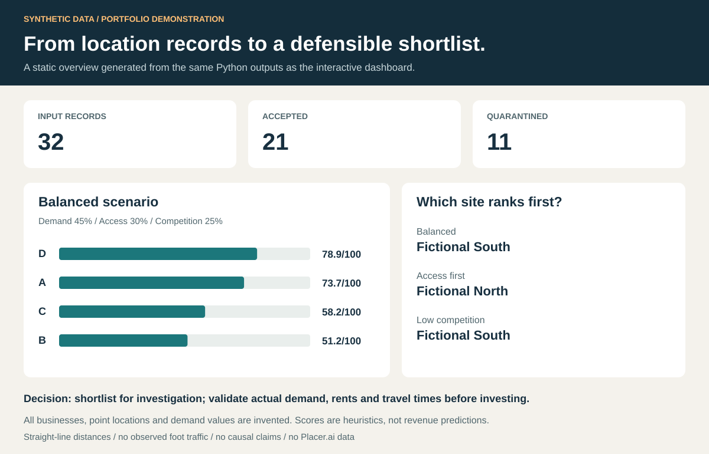

# Sergio Cárdenas · Geospatial Analytics Portfolio

Environmental engineer working with ArcGIS, Python and geographic data quality. This portfolio connects data preparation, spatial reasoning and clear communication of results.

**First review version.** The Python examples are newly prepared, AI-assisted portfolio demonstrations using synthetic data. They are not client projects, professional achievements or evidence of commercial impact. The GEOTIP case links existing work. Author review and a recorded walkthrough are still pending.

## Selected projects

| Project | Question | Evidence | Status |
|---|---|---|---|
| [Location Data Quality](projects/01-location-data-quality/README.md) | Which location records can safely enter an analysis? | Python validation, quarantine log, GeoJSON and source hashes | Working synthetic demonstration |
| [Location Screening](projects/02-location-screening/README.md) | How does a location shortlist change when priorities change? | Distance features, transparent weights, sensitivity scenarios and business brief | Working synthetic demonstration |
| [GEOTIP Dashboard Expressions](projects/03-geotip/README.md) | How can earthquake data feed a useful ArcGIS dashboard? | Existing public Arcade expressions and a candid technical review | Existing source reviewed; live application not verified |

## Review in two minutes

1. Read the [screening brief](outputs/screening_brief.md).
2. Inspect the [interactive dashboard source/output](outputs/dashboard.html). Download it and open it in a browser; GitHub's file viewer displays HTML source.
3. Review [the implementation](src/portfolio.py), [QA results](outputs/report.json), and [tests](tests/test_portfolio.py).
4. Review the original [GEOTIP repository](https://github.com/sergiopreserva/dashboards-codigos-geotip).



## Reproduce

Python 3.10 or newer; standard library only. No ArcGIS license, credentials, external APIs or package installation is needed for the two synthetic demos.

```bash
python src/portfolio.py
python -m unittest discover -s tests -v
```

Open `outputs/dashboard.html` after running the script. Outputs are deterministic for the bundled input files. Raw input files remain unchanged. The accepted GeoJSON can also be opened in ArcGIS Pro or QGIS.

## What this demonstrates

- Data cleaning with traceable rejection reasons instead of silent fixes.
- Spatial feature engineering using distances in metres.
- Reproducible scoring with explicit assumptions and sensitivity checks.
- Interactive communication of evidence and limitations.
- Existing use of Arcade and ArcGIS Dashboards.

The custom HTML dashboard is not evidence of Tableau or Power BI proficiency. The synthetic examples do not establish real-market demand, observed visits, sales forecasts, causality or measured efficiency gains.

## Data and scope

All bundled business names, point locations and demand indices are invented. The approximate Bogotá-area context is illustrative. No client records, private services, Placer.ai data or mobile-device observations are included. See [provenance and dictionary](data/README.md).

[Preparation guide in Spanish](START_HERE_ES.md) · [Interview preparation](docs/INTERVIEW_GUIDE_ES.md)
